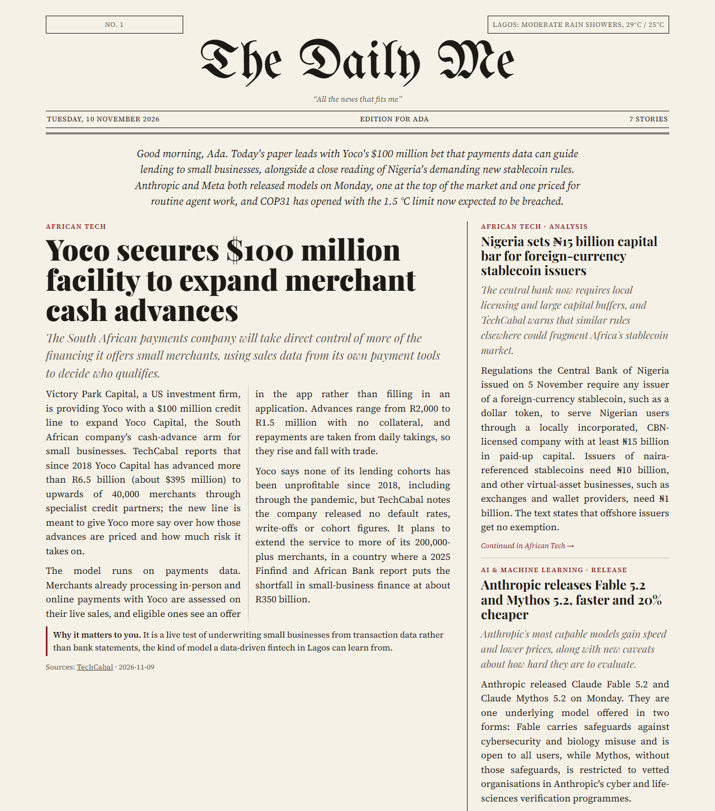
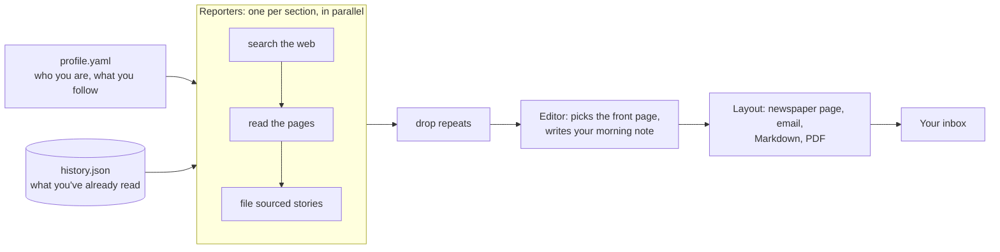

<p align="center">
  
</p>

# The Daily Me

**Your own AI-written newspaper, every morning.**

The Daily Me reads the web for the things you care about, writes the stories in plain English with a link to every source, and lays them out like a real newspaper: a front page, your sections, short briefs and the weather. It runs on [Claude](https://www.anthropic.com/claude), costs well under a coffee a day, and can land in your inbox every morning from a free GitHub Actions schedule. No server, no subscription, no ads.

[**See a sample edition**](https://romanthegentle.github.io/daily-me/sample-edition.html) · [How it works](#how-it-works) · [Get started](#get-started) · [How it compares](#how-it-compares)

## Why

In 1995 Nicholas Negroponte imagined *The Daily Me*: a newspaper edited for one reader. Thirty years later, AI can finally write it.

Cass Sunstein later warned that a paper built only from your own tastes becomes an echo chamber. So every edition of this one also carries **one story from outside your bubble**: something you'd never have searched for, chosen because it's worth knowing.

## What you get

- **A real front page:** a lead story, the next most important stories and a short morning note written for you.
- **Your sections, researched fresh each day:** a Claude reporter per section searches the web, opens the most promising pages and reads them before writing anything.
- **"Why it matters to you"** on every story, based on what your profile says about your work and goals.
- **A source on every story.** Stories without a real link are dropped before they reach the page.
- **No repeats.** The paper remembers what it has told you and only comes back to a story when there's real news.
- **One story from outside your bubble,** every day.
- **The weather** for your city, from Open-Meteo.
- **Delivery your way:** email, a newspaper web page, Markdown, or a print-ready PDF (handy for a Kindle or reMarkable).
- **A cost meter.** Every run prints what it spent.

## How it works



1. **Reporters.** Each section is one Claude conversation with Anthropic's server-side web search and web fetch tools. The reporter is told who you are, what the section covers, what you've already read this week and what to leave out. It searches, reads, and files its stories through a strict, schema-checked tool: headline, dek, body, why it matters, importance and sources.
2. **Checks.** Stories with no valid source, stories you've already seen and duplicates filed by two reporters are dropped.
3. **Editor.** A final call picks the lead and the front-page stories and writes a two-sentence note for you.
4. **Layout.** Jinja templates turn the edition into a newspaper page, an email and Markdown. Headless Chrome or Edge prints the PDF.

The edition itself is plain JSON (run `dailyme schema` to see its shape), so you can build your own layouts on top.

## Get started

You need Python 3.10 or newer.

### 1. Try it in 30 seconds, without an API key

```bash
pip install git+https://github.com/romanthegentle/daily-me.git
dailyme demo
```

Then open `editions/2026-11-10.html` in your browser.

### 2. Make your own edition

```bash
dailyme init                       # writes profile.yaml for you to edit
export ANTHROPIC_API_KEY=sk-ant-...   # from https://console.anthropic.com
dailyme run                        # research, write and lay out today's paper
```

On Windows PowerShell, use `$env:ANTHROPIC_API_KEY = "sk-ant-..."` instead of `export`.

**Let your AI assistant fill in your profile.** It already knows what you care about. Ask Claude or ChatGPT: *"Describe my work, my interests and the topics I follow, in detail."* Save the answer as `about-me.txt`, then run:

```bash
dailyme init --from-text about-me.txt
```

It drafts your sections and leaves out anything sensitive a newspaper doesn't need. Read it over before your first edition.

### 3. Get it every morning with GitHub Actions

1. Click **Use this template** on this repository and create a **private** repository from it. Private matters: logs and downloads of public repositories are visible to everyone.
2. In your new repository, open **Settings → Secrets and variables → Actions** and add:
   - the secret `ANTHROPIC_API_KEY`;
   - the variable `DAILYME_PROFILE`, with your whole `profile.yaml` pasted in;
   - for email, the secrets `DAILYME_SMTP_HOST`, `DAILYME_SMTP_PORT`, `DAILYME_SMTP_USER`, `DAILYME_SMTP_PASSWORD`, `DAILYME_EMAIL_FROM` and `DAILYME_EMAIL_TO`.
3. Open **Actions → Daily edition → Run workflow** to test it. After that it runs every morning at 05:30 UTC; change the `cron` line in `.github/workflows/daily-edition.yml` to suit your time zone.

Any SMTP provider works. With Gmail, create an [app password](https://support.google.com/accounts/answer/185833) and use `smtp.gmail.com` on port `587`. To read the paper on a Kindle, add your Send-to-Kindle address to `DAILYME_EMAIL_TO` and set `attach_pdf: true` in your profile.

### 4. Or let Claude Code make it, on your Claude plan

Open this repository in [Claude Code](https://claude.com/claude-code) and ask:

> Write today's edition of my Daily Me.

The project skill in [`.claude/skills/daily-me`](.claude/skills/daily-me/SKILL.md) does the reporting with Claude Code's own web tools, saves the edition as JSON and runs `dailyme render` to lay it out (add `--send` to email it). No API key is needed. The [sample edition](https://romanthegentle.github.io/daily-me/sample-edition.html) was made this way.

## Your profile

Everything the paper knows about you lives in `profile.yaml`. See [`profile.example.yaml`](profile.example.yaml) for every option.

| Setting | What it does |
|---|---|
| `reader.about` | A few sentences about your work and goals. Powers "why it matters to you". |
| `reader.location` | Localises searches, sets your time zone, and turns on the weather box. |
| `sections` | Your beats: a name, specific interests, optional RSS feeds, and how many stories and briefs. |
| `serendipity` | The daily story from outside your bubble. On by default. |
| `avoid` | Topics to leave out. |
| `sources.prefer` / `sources.block` | Outlets to favour, and domains never to use. |
| `settings.model` | Any current Claude model. Default `claude-opus-5-5`. |
| `settings.effort` | How hard each reporter thinks: `low` to `max`. Default `medium`. |
| `settings.window_hours` | How far back each edition looks. Default 36 hours. |
| `delivery` | Email subject, PDF printing and PDF attachments. |

## What it costs

Each run prints its own cost, worked out from the API's usage figures at list prices. The cost comes from two things:

- **Web searches** at $10 per 1,000. A default edition (three sections and the bubble story) makes up to 20.
- **Tokens:** mostly the pages the reporters read.

Expect roughly $0.50 to $2 an edition on the default Claude Opus 5.5. Claude Sonnet 5.5 costs about half that, and Claude Haiku 5.5 costs mainly the search fees. Fewer sections, searches and page reads cost less again. The Claude Code mode runs on your Claude plan and needs no API credit.

## Privacy, accuracy and safety

- **Your data stays yours.** Your profile, editions and history stay on your machine or in your own repository. Only the Claude API sees your profile, as part of each request.
- **Sources on everything.** Reporters may only report what the pages they opened say, and every story links to them. AI can still get things wrong, so check a source before you rely on a detail.
- **Summaries, not copies.** Stories are written in the paper's own words, with short credited quotes at most, and link to the original. The paper never reproduces articles.
- **Web pages can't give orders.** Reporters treat search results and pages as material, not instructions. Their only tools are web search, reading pages that turned up in their research, and filing stories. Filings are schema-checked, links must be `http(s)`, and all text is escaped in the layout.
- **The model never chooses where your paper goes.** Email recipients are fixed in your settings, and sending is ordinary code that runs after the AI has finished.
- **No paywall tricks.** The paper uses Claude's web search and fetch tools, honours what sites allow, and never bypasses a paywall.
- **Refusal fallbacks.** On models that support it, a declined request is retried server-side on a recommended model (`settings.fallbacks`).

## How it compares

AI morning briefings are everywhere now, but a personal *newspaper* that you own is still rare.

| | The Daily Me | Briefings from AI assistants | Feed and digest tools |
|---|---|---|---|
| Format | A laid-out newspaper: front page, sections, briefs, weather | Cards, chat or audio | Ranked lists and summaries |
| Open source and self-hosted | Yes, MIT licensed | No | Some |
| Your interests | A profile you control, which your AI assistant can draft for you | The platform's memory and connected apps | Feeds, libraries and scoring rules |
| Sources | Required on every story; unsourced stories are dropped | Varies | Links to items |
| Remembers what you've read | Yes | Varies | Some |
| Breaks your bubble on purpose | Yes, one story a day | No | No |
| Print and e-reader output | PDF | No | Rarely |
| Cost | Your own API usage, or your Claude plan through Claude Code | Subscription | Free to subscription |

Good neighbours: [Horizon](https://github.com/Thysrael/Horizon) is a multi-source news radar, [zotero-arxiv-daily](https://github.com/TideDra/zotero-arxiv-daily) recommends new papers from your Zotero library, and [Calibre's news recipes](https://manual.calibre-ebook.com/news.html) turn sites into e-books.

## Roadmap

- A fact-check pass that compares each story's claims with its sources before printing.
- One-click "more like this / less like this" links that tune your profile.
- EPUB and audio editions.
- Telegram and Slack delivery.
- An evaluation set that scores editions for accuracy and faithfulness to their sources.

Ideas and pull requests are welcome; see [CONTRIBUTING.md](CONTRIBUTING.md).

## Development

```bash
git clone https://github.com/romanthegentle/daily-me.git && cd daily-me
python -m venv .venv && source .venv/bin/activate
pip install -e ".[dev]"
pytest
```

The tests use a fake Claude client, so they're free and need no API key.

## Citing

If you use The Daily Me in research, please cite it using [`CITATION.cff`](CITATION.cff).

## Credits

Created by Joshua C. Udotai, built with [Claude Code](https://claude.com/claude-code). Weather data by [Open-Meteo](https://open-meteo.com). MIT licensed.
